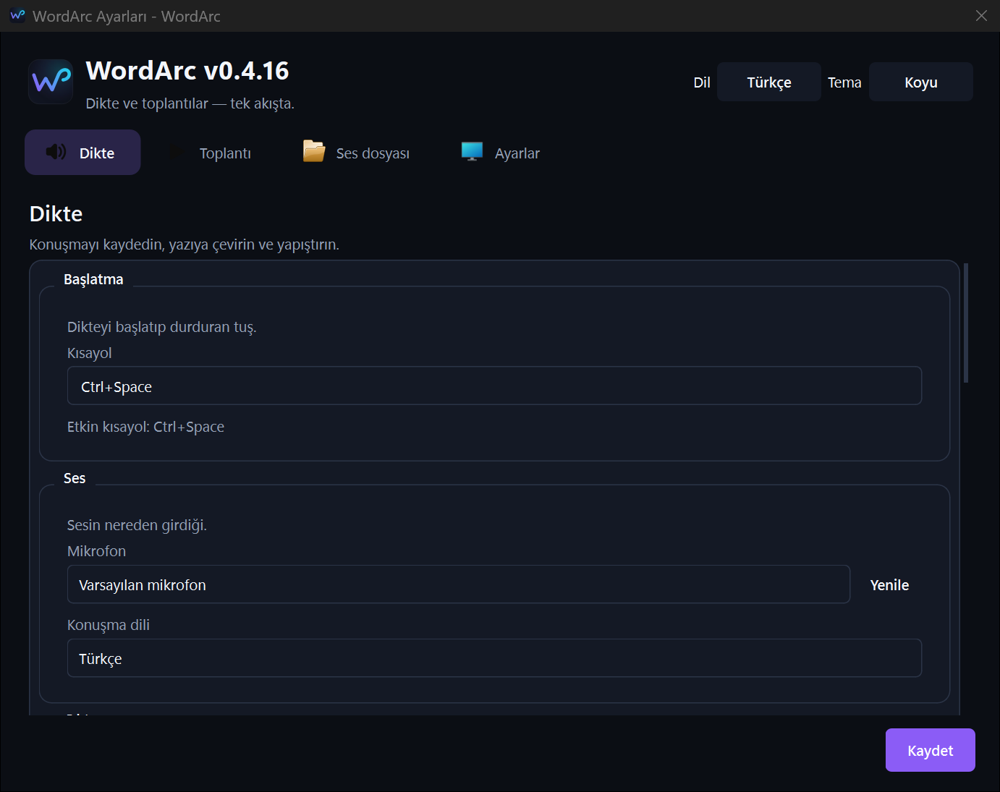

# WordArc — Voice-to-text for Windows

> Türkçe için: [README.tr.md](./README.tr.md)

WordArc turns speech into polished text. Press `Ctrl+Space`, talk, press again — the text is transcribed, cleaned up, and pasted where you work. It also captures microphone and system audio for reliable meeting minutes.



## Features

- **Push-to-talk dictation** — `Ctrl+Space` to start/stop, `Escape` discards without transcription or AI processing.
- **Meeting mode** — `wordarc.py meeting` records mic + system audio (WASAPI loopback), writes minutes-grade transcripts.
- **System-audio capture** — meeting counterparts are captured even without a mic share.
- **Voice activity detection** — trims silence before sending audio.
- **Paste where you work** — result is pasted into the focused app.
- **Tray service** — dictation, agent, meeting, and settings actions from the tray menu; single instance via local IPC.
- **Transcript history (opt-in)** — off by default; when on, history is plain local text files.
- **Privacy by default** — successful meeting audio is deleted by default; Gemini key lives in Windows Credential Manager (`WordArc/GeminiApiKey`).
- **Bilingual UI** — Turkish and English; dark default with light and system themes.
- **Legacy migration** — first launch copies missing files atomically from previous installs, never overwrites existing WordArc files.

## Quick start (zero-install state)

1. Download the current `WordArc-X.Y.Z.exe` and `install.ps1` into the same folder, run `install.ps1`.
2. Start WordArc — Settings opens on first launch. Enter your Gemini API key.
3. Press `Ctrl+Space` once, talk, press again. The polished text is pasted.

CLI:

```powershell
python wordarc.py             # open Settings, keep tray service running
python wordarc.py background  # run in background (Windows startup)
python wordarc.py toggle      # start / stop recording
python wordarc.py cancel      # discard the current recording
python wordarc.py meeting     # start / end a meeting recording
python wordarc.py settings    # open the settings window
python wordarc.py quit        # shut the application down
```

## Development

```powershell
python -m venv .venv
.\.venv\Scripts\pip install -r requirements-lock.txt -r requirements-dev.txt
python wordarc.py
```

Checks and build:

```powershell
.\check.ps1
.\build.ps1
```

`check.ps1` runs pytest, compileall, and an import check over all modules. `build.ps1` verifies the pinned FFmpeg binary, runs tests, audits dependencies, emits `sbom.json`, renders the deterministic icon, and packages `dist\WordArc-X.Y.Z.exe` plus its matching launcher `.bat` via PyInstaller.

## Data and privacy

- Settings: `%APPDATA%\WordArc\config.json`
- Recordings, meetings, diagnostics: `%LOCALAPPDATA%\WordArc\`
- Gemini key: Windows Credential Manager, `WordArc/GeminiApiKey`
- History off by default; meeting audio deleted after success by default.
- `verbatim.py` stays one release as a compatibility entry point.

## Project structure

```text
wordarc.py        tray app, CLI, single-instance IPC
worker.py         dictation pipeline
meeting.py        meeting pipeline
audio*.py         mic + WASAPI loopback capture
settings_ui.py    settings window
hotkey.py         global hotkey
assets/brand      canonical SVG sources, icon build
tools/            brand asset + helper scripts
tests/            pytest suite
```

## FAQ

- **Nothing happens on `Ctrl+Space`?** Another app may own the hotkey — change or free it, then `wordarc.py restart`.
- **Meeting has no counterpart audio?** System-audio capture needs loopback; check Windows sound settings.
- **Key rejected?** Re-enter it in Settings; it is stored only in Credential Manager.

## Roadmap

- Clean-install screenshots in `docs/screenshots/`
- More grammars for cleanup polish
- Per-app paste profiles

## Contributing

See [CONTRIBUTING](./.github/PULL_REQUEST_TEMPLATE.md) flow: open an issue, keep PRs small, run `.\check.ps1` before pushing.

## License

GPL-3.0. The original Linux project was created by [yusufipk](https://github.com/yusufipk/dikte).
