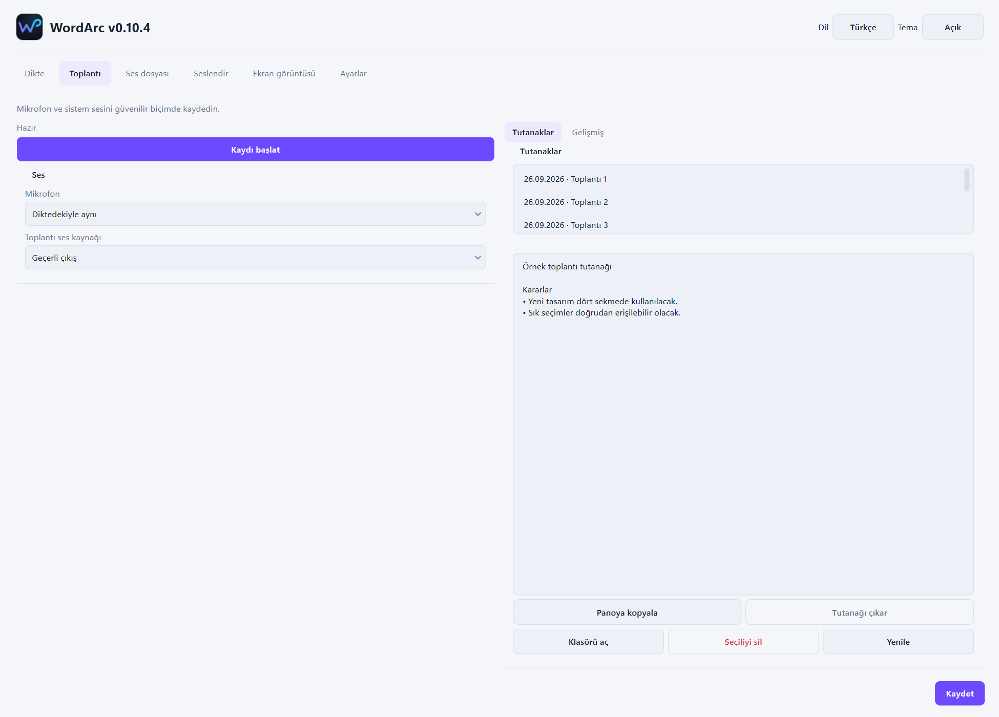
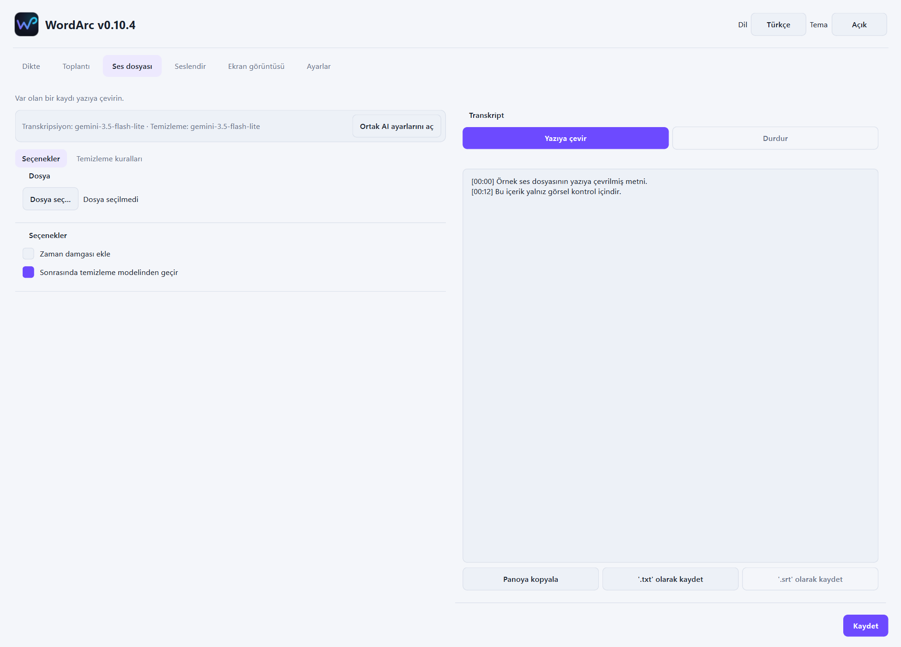
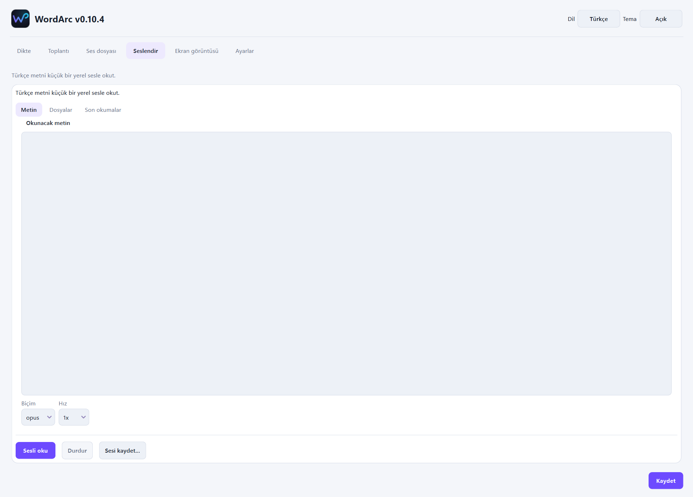
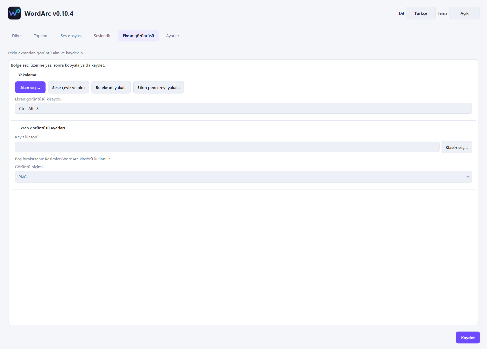
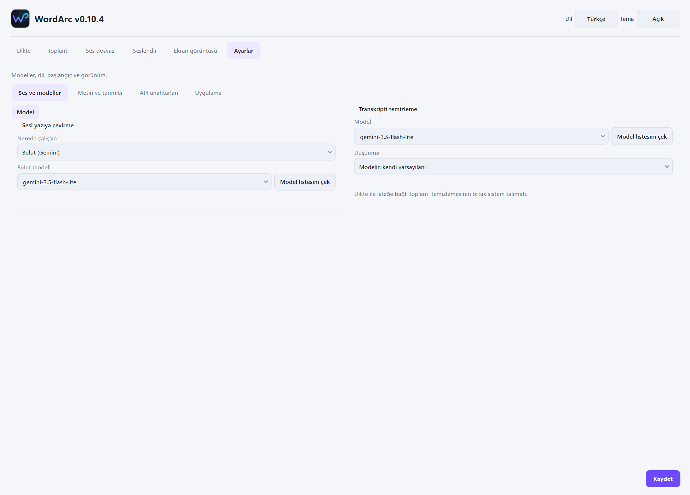
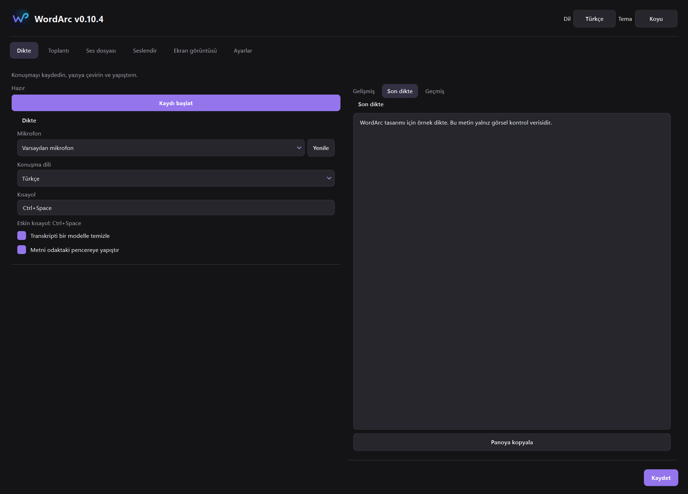
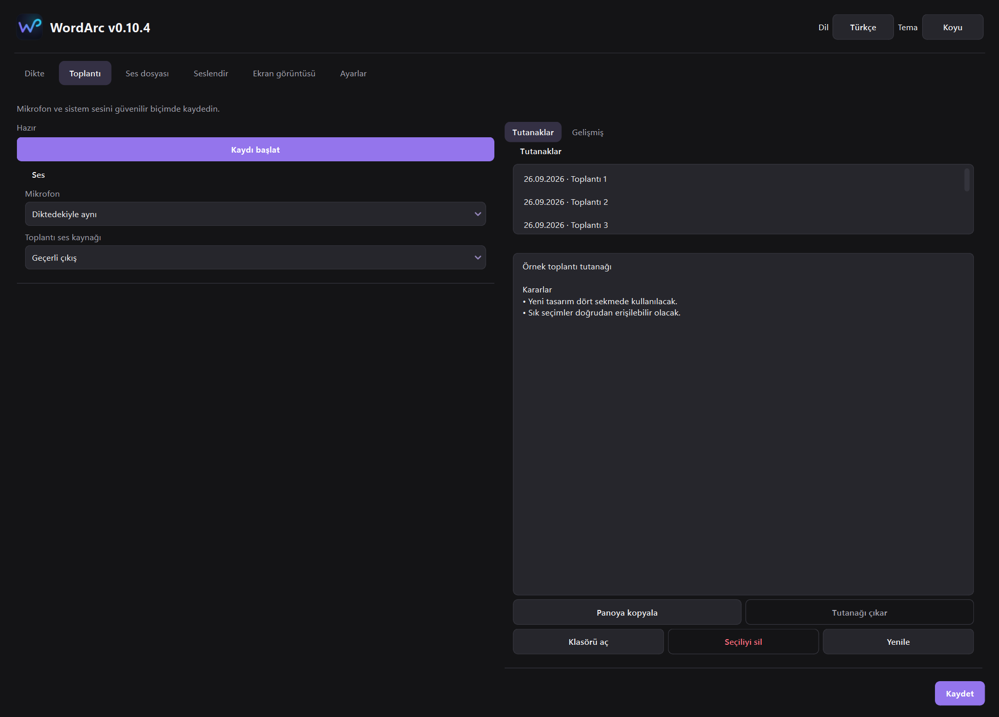
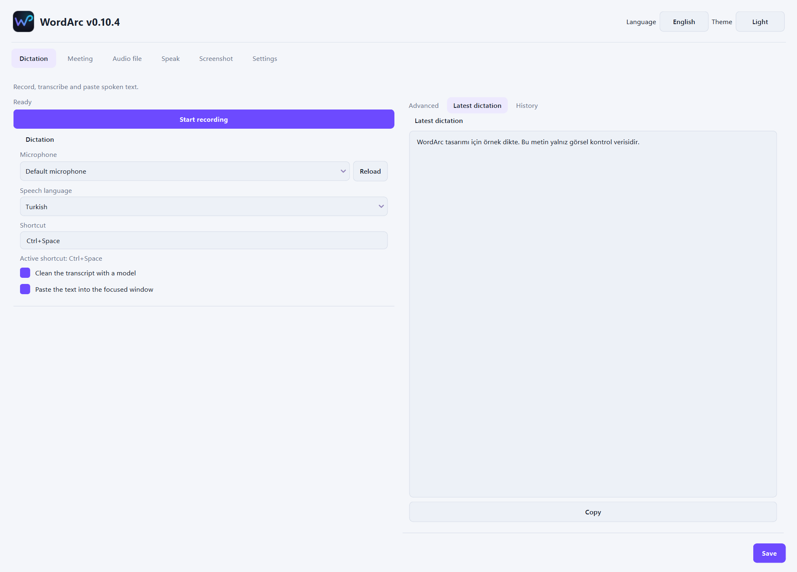

# WordArc — Voice-to-text for Windows

> Türkçe: [README.tr.md](./README.tr.md)

**Press `Ctrl+Space`, talk, press again. The text lands where you work — cleaned up.**

WordArc is a Windows dictation and transcription tool. It records your microphone (and, in meeting mode, your system audio too), transcribes it locally or through Gemini, polishes the result with an AI cleanup pass, and pastes it into whatever window had focus. No cloud clipboard, no account, no background upload of your audio.


---

## Contents

- [What it does](#what-it-does)
- [Screens, one by one](#screens-one-by-one)
  - [1. Dictation](#1-dictation)
  - [2. Meeting](#2-meeting)
  - [3. Audio file](#3-audio-file)
  - [4. Speak](#4-speak)
  - [5. Screenshot](#5-screenshot)
  - [6. Settings](#6-settings)
  - [7. Dark theme](#7-dark-theme)
  - [8. English interface](#8-english-interface)
- [Install](#install)
- [Command line](#command-line)
- [Build from source](#build-from-source)
- [Speech engines](#speech-engines)
- [Data and privacy](#data-and-privacy)
- [Project structure](#project-structure)
- [Troubleshooting](#troubleshooting)
- [License](#license)

---

## What it does

| Capability | Detail |
|---|---|
| **Push-to-talk dictation** | `Ctrl+Space` starts and stops; `Escape` discards without transcribing |
| **Meeting mode** | microphone + system audio via WASAPI loopback, minutes-grade output |
| **Audio file transcription** | any file ffmpeg can read, with timestamps and `.srt` export |
| **Read aloud** | text-to-speech with speed and format control, saveable to a file |
| **Screenshot capture** | `Ctrl+Alt+S` region select, OCR-style "read this aloud", clipboard, PNG/JPEG |
| **Cleanup pass** | an AI model removes filler words, fixes punctuation and keeps meaning |
| **Local or cloud** | whisper on CPU/CUDA/Vulkan, or Gemini — your choice per mode |
| **Bilingual UI** | Turkish and English, dark / light / system themes |

---

## Screens, one by one

### 1. Dictation


The default tab, built around one button.

**Left panel — capture**
- `Kaydı başlat` / *Start recording* — begins capture. The same action is bound to `Ctrl+Space` globally, so you can dictate into any application.
- **Microphone** selector with a refresh button, so a headset plugged in mid-session appears without a restart.
- **Language** selector for the dictation model.
- **Hotkey** field — the global shortcut, editable.
- **Clean the transcript with a model** — when on, the raw transcript goes through the cleanup prompt before it is pasted.
- **Paste the text into the focused window** — when off, the result stays in WordArc for you to copy manually.

**Right panel — result**
- `Gelişmiş` / *Advanced* — model, prompt language, per-run overrides.
- `Son dikte` / *Last dictation* — the final text, editable before you copy it.
- `Geçmiş` / *History* — previous dictations, off by default.

`Panoya kopyala` copies the text. `Kaydet` saves the tab's settings.

**Why two steps.** Recording and transcription are separate: the recording finishes first, then transcription runs, then cleanup runs. If cleanup fails you still have the raw transcript — WordArc never discards the transcription because the polish step broke.

### 2. Meeting



Records both sides of a call without asking anyone to share their screen.

**Left panel**
- `Kaydı başlat` — start/stop the meeting recording.
- **Microphone** — `Diktedekiyle aynı` / *Same as dictation*, or a specific device.
- **Meeting audio source** — `Geçerli çıkış` / *Current output* captures what you hear through WASAPI loopback, so the other participants are recorded even on headphones.

**Right panel**
- `Tutanaklar` / *Minutes* — one entry per recording, timestamped.
- `Gelişmiş` / *Advanced* — model and prompt overrides for this meeting only.
- The transcript preview, editable.
- `Panoya kopyala`, `Tutanağı çıkar` (produce minutes), `Klasörü aç` (open the folder), `Seçiliyi sil`, `Yenile`.

**Audio handling.** The recording is written to `%LOCALAPPDATA%\WordArc\` and deleted after a successful transcription by default. If transcription fails, the audio stays so you can retry — nothing is silently thrown away.

### 3. Audio file



Transcribe an existing recording instead of a live one.

**Left panel**
- `Ortak AI ayarlarını aç` — jump to the shared model settings.
- Current model shown read-only (`gemini-3.5-flash-lite` in the capture).
- `Seçenekler` / *Options* and `Temizleme kuralları` / *Cleanup rules* sub-tabs.
- `Dosya seç` — pick the audio file.
- **Add timestamps** — prefix each segment with its offset.
- **Run through the cleanup model afterwards** — same polish pass as dictation.

**Right panel**
- `Yazıya çevir` / *Transcribe*, `Durdur` / *Stop* — the stop is cooperative; a partial transcript is kept.
- The transcript box.
- `Panoya kopyala`, `'.txt' olarak kaydet`, `'.srt' olarak kaydet` — subtitle export uses the timestamps.

Long files stream: the progress bar advances and the partial text appears while the file is still being processed, so you can stop early if the first minutes are wrong.

### 4. Speak



Text-to-speech, in the same window.

- **Text to read** — paste or type anything.
- **Format** — `opus` and the other bundled encoders.
- **Speed** — `1x` and multiples.
- `Sesli oku` / *Read aloud*, `Durdur` / *Stop*.
- `Sesi kaydet...` / *Save the audio* — writes the rendered speech to a file.

The voice models are vendored into the build, so this tab works offline.

### 5. Screenshot



Capture and reuse what is on screen.

- `Alan seç...` / *Select a region* — the same action as the global `Ctrl+Alt+S`.
- `Sese çevir ve oku` / *Read it aloud* — OCR the capture and speak the text.
- `Bu ekranı yakala` / *Capture this screen*, `Etkin pencereyi yakala` / *Capture the active window*.
- **Shortcut** field — the global capture hotkey.
- **Save folder** with `Klasör seç...`, and an image format selector (`PNG`).

Captures stay local. Nothing is uploaded for the read-aloud path — the OCR runs on your machine.

### 6. Settings



Four categories down the left, each with its own panel.

**Speech and models**
- **Where it runs** — `Bulut (Gemini)` / *Cloud (Gemini)* or a local engine.
- **Cloud model** — the transcription model, with `Model listesini çek` / *Fetch the model list*.
- **Cleanup model** — a separate model for the polish pass, so you can use a cheap model for cleanup and a better one for transcription.
- **Thinking** — `Modelin kendi varsayılanı` / *the model's own default*, or forced on/off.
- **Description** — the shared system instruction used by both dictation and meeting cleanup. Editing it changes how aggressively the text is rewritten.

**Text and terms** — custom vocabulary and replacements, so names and jargon survive transcription.

**API keys** — stored in Windows Credential Manager under `WordArc/GeminiApiKey`, never in `config.json`.

**Application** — theme, language, startup behaviour, tray behaviour.

`Kaydet` writes the settings. Changes that affect a running recording take effect on the next one, never mid-recording.

### 7. Dark theme





Dark is the default. Every panel, table, status colour and disabled state is drawn for both themes; the layout does not shift when you switch. `Sistem` follows the Windows setting.

### 8. English interface



The language switch in the top bar changes the entire interface, not just labels — including dialogs, error messages and the cleanup prompts. Switching language does not restart the application or interrupt a recording.

---

## Install

1. Download `WordArc-<version>.exe` from [Releases](https://github.com/zeitgeist-c/WordArc/releases/latest).
2. Run it. It installs to `Program Files\WordArc` with an administrator prompt; the installer is roughly 500 MB.
3. Settings opens on first launch. Enter your Gemini API key, or select a local model.
4. Press `Ctrl+Space`, talk, press again.

GPU support is downloaded on demand — the base installer does not carry CUDA libraries. On an NVIDIA card WordArc fetches the CUDA runtime the first time you select a GPU device; on AMD it uses the bundled whisper.cpp Vulkan engine with a separate GGML model download. Previously downloaded CPU or CUDA weights stay on disk and keep working.

## Command line

```powershell
python wordarc.py             # open Settings, keep the tray service running
python wordarc.py background  # run in the background (Windows startup)
python wordarc.py toggle      # start / stop recording
python wordarc.py cancel      # discard the current recording
python wordarc.py meeting     # start / end a meeting recording
python wordarc.py settings    # open the settings window
python wordarc.py quit        # shut the application down
```

A single instance is enforced through local IPC: running `toggle` while WordArc is already open reaches the running process instead of starting a second one.

## Build from source

```powershell
python -m venv .venv
.\.venv\Scripts\pip install -r requirements-lock.txt -r requirements-dev.txt
python wordarc.py
```

Checks and packaging:

```powershell
.\check.ps1
.\build.ps1
```

`check.ps1` runs pytest, `compileall` and an import check over every module. `build.ps1` verifies the pinned FFmpeg binary, runs the tests, audits dependencies, emits `sbom.json`, renders the deterministic icon, vendors the TTS weights, and produces the installer through PyInstaller + Inno Setup.

`build.ps1 -Cuda` additionally prepares and verifies the NVIDIA DLL set; without the flag the package carries the CPU and Vulkan engines only.

## Speech engines

| Engine | Where it runs | Notes |
|---|---|---|
| **Gemini** | cloud | needs an API key; fastest for long meetings |
| **faster-whisper (CPU)** | local | default local path, no GPU needed |
| **faster-whisper (CUDA)** | local GPU | downloaded on demand, NVIDIA only |
| **whisper.cpp Vulkan** | local GPU | AMD path since 0.6.9, separate GGML model |

`Otomatik` / *Automatic* picks CUDA, then Vulkan, then CPU. If a GPU engine fails mid-recording, an automatic run retries the same audio on CPU; an explicit AMD/NVIDIA choice asks for consent first. Audio never leaves the machine in the local paths.

## Data and privacy

- Settings: `%APPDATA%\WordArc\config.json`
- Recordings, meetings, diagnostics, downloaded models: `%LOCALAPPDATA%\WordArc\` — speech models under `whisper`, GPU runtime under `cuda`. The installer and uninstaller never touch these.
- Gemini key: Windows Credential Manager, `WordArc/GeminiApiKey`.
- History is **off** by default. When enabled it is plain local text files.
- Successful meeting audio is deleted by default.
- No telemetry. The only network calls are the model list, the transcription request when you choose a cloud engine, and update checks.

## Project structure

```text
wordarc.py             tray app, CLI, single-instance IPC
worker.py              dictation pipeline
meeting.py             meeting pipeline
audio.py, audio_capture.py   microphone and WASAPI loopback capture
settings_ui.py         the six-tab window
screenshot_capture.py  region and full-screen capture, local preview
hotkey.py              global hotkeys
api.py, cleanup         Gemini client and the cleanup pass
filetranscribe.py      audio-file transcription
livespeech.py          read-aloud
engine_discovery.py    local model discovery and selection
cuda_*.py, cuda_libs.py  CUDA detection, recovery and DLL staging
brand.py, theme.py, i18n.py  identity, theming, Turkish/English strings
assets/brand           canonical SVG sources and icon build
tools/                 packaging, verification and screenshot harnesses
tests/                 pytest suite
```

## Troubleshooting

- **`Ctrl+Space` does nothing** — another application owns the hotkey. Change it in the Dictation tab, or free it, then `python wordarc.py restart`.
- **Meeting has no other-side audio** — loopback capture needs an active output device. Check the Windows sound settings and that the meeting audio source is `Geçerli çıkış`.
- **Key rejected** — re-enter it in Settings; it is stored only in Credential Manager, so a Windows profile reset removes it.
- **GPU engine fails late** — an automatic run retries on CPU; an explicit GPU choice asks before falling back. A Vulkan-free CPU payload can use already downloaded GGML weights without another download.
- **Cleanup returns empty text** — an empty cleanup result is never pasted and never counted as success; the raw transcript is kept.

## License

GPL-3.0. The original Linux project was created by [yusufipk](https://github.com/yusufipk/dikte).
