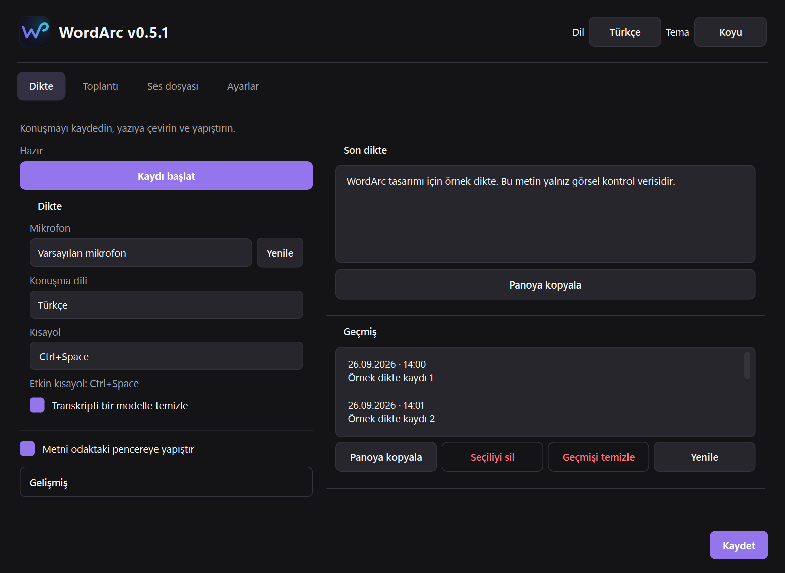
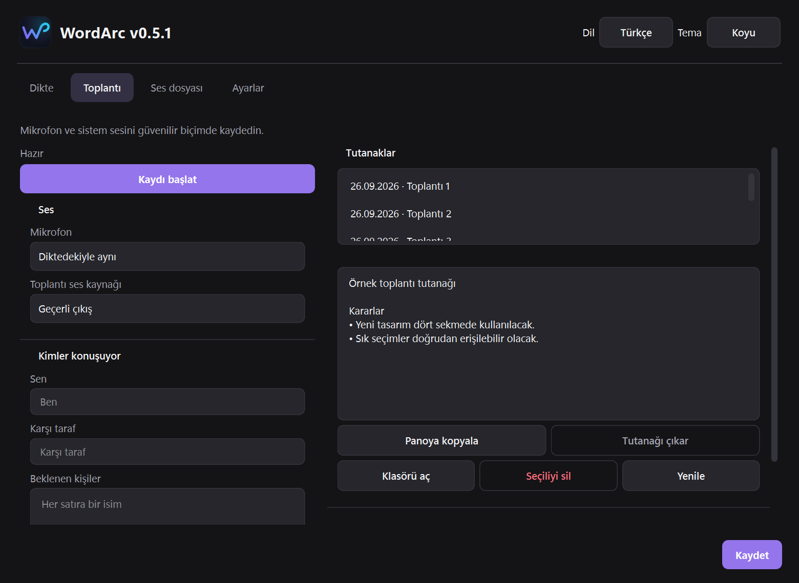
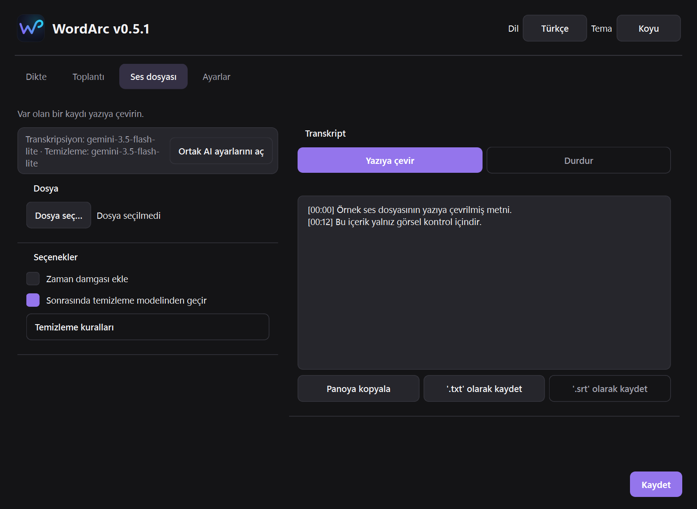
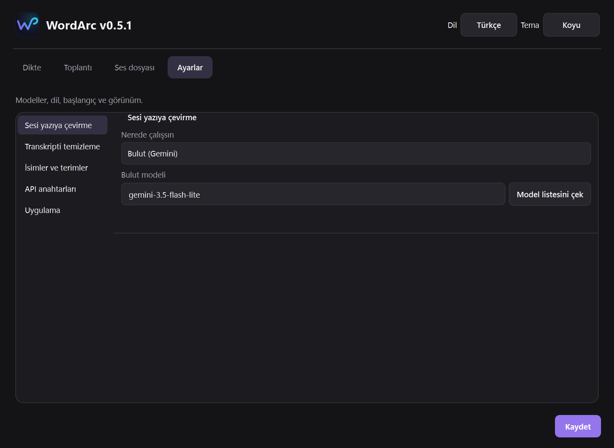

# Yeni WordArc çalışma alanı

Dört üst sekme korunur. Sık kullanılan seçimler solda, metin ve arşiv alanları sağdadır. Dar pencerede sütunlar alt alta geçer. Gelişmiş ayarlar kapalı başlar; uzun cihaz ve model seçimleri aranabilir pencereler kullanır. Ayarlar sekmesi kısa bölüm menüsüyle ayrılır.

Ctrl+Space ve tepsiyle dikte mevcut otomatik yapıştırma tercihini kullanır. Pencere düğmesiyle başlatılan dikte metni sonuç alanına ve panoya verir; otomatik yapıştırmaz. Bu seçim işlem bazındadır, kalıcı otomatik yapıştırma ayarını değiştirmez. Pencereden başlatma başarılı kaydetme gerektirir; bitirme ve iptal yeniden kaydetme gerektirmez. Son dikte geçmiş kapalıyken yalnız oturum belleğindedir.

## Görünüm

Görüntüler izole test ayarları ve örnek içerikle gerçek Windows Qt platformunda alınmıştır. Kullanıcı verileri ve gerçek API anahtarları kullanılmamıştır.

## Doğrulama

- `check.ps1 -Python .\.venv\Scripts\python.exe`: 244 test geçti, 2 test atlandı; compileall ve modül yükleme kontrolleri geçti.
- Türkçe/İngilizce, açık/koyu, 1040×760 ve 520×400 pencereler; %100, %125 ve %150 Qt ölçekleriyle görseller üretildi ve incelendi.
- Kayıt başlatma için kaydetme kapısı, işleme sırasında tekrar başlatmanın engellenmesi, kayıt denetleyicisine yönlendirme ve açık pencerenin gerçek işlem durumunu alması test edildi.
- İşlem bazında otomatik yapıştırma farkı, kalıcı tercihin korunması, geçmiş kapalıyken sonuç saklamama, cihaz arama ve kimlik seçimi test edildi.
- Gerçek mikrofon kaydı, gerçek uygulamaya otomatik yapıştırma, canlı Gemini çağrısı ve gerçek model indirme bu çalışmada denenmedi.

## 0.5.0 sürüm doğrulaması

- Dağıtım: `dist/WordArc-0.5.0.exe` ve aynı EXE'yi başlatan `dist/WordArc-0.5.0.bat`.
- EXE içindeki gerçek sürüm, beklenen modüller ve BAT hedefi `tools/verify_release_package.py` ile kontrol edilir. Bu kontrol `build.ps1` içinde zorunludur.
- Bağımlılık denetimi bilinen güvenlik açığı bulmadı.
- Konsol doğrulama paketi dört sekmeyi geçici ayarlar/kimlik bilgisi taklitleriyle açtı ve görüntüler üretti: `FROZEN WORKSPACE OK version=0.5.0 frozen=True`.
- Qt'nin Windows ICU API'siyle çakışan, derleme ortamındaki Poppler DLL'inin pakete taşınması engellendi. Aynı kural teslim ve doğrulama spec dosyalarındadır.
- Bu doğrulama gerçek ses tanıma veya canlı API testi değildir; kullanıcı verileri üzerinde çalıştırılmaz.

Planlanan yerel sürüm etiketi: v0.5.1. Commit otomatik onay denetiminde proje dosyasındaki tmm koşulu nedeniyle reddedildi; yerel commit ve etiket henüz oluşturulmadı. Önceki dönüş noktası: 4ae6c7d / v0.4.24. Eski paketler korunur. GitHub gönderimi ayrı onay bekler; deployment tanımlı değildir.

Teslim paketindeki brand/settings_ui/theme modülleriyle konsol doğrulama paketindeki modüller bytecode düzeyinde aynıdır.

EXE SHA256: `2cd1b0fee57cf27a60aef3cbb3a2aaf67e368ccc3af9d3fbb1264c12ef417de7`.

## 0.5.1 — bütün seçimler ve Gelişmiş alanı

- 18 seçim alanının tamamı aynı aramalı pencereyi kullanır; kısa seçenekler eski Qt listesini açmaz.
- Düzenlenebilir model/kısayol alanlarının metnine tıklama da pencereyi açar. Özel değer girişi seçim penceresinde korunur.
- Gelişmiş açıldığında kaydırma alanının içerik yüksekliği yeniden hesaplanır; son kontrol büyük ve küçük pencerede erişilebilir.
- 44 modellik örnek liste, tüm seçim alanları ve Gelişmiş bölümleri açık/koyu temalarda gerçek Windows Qt ile görüntülendi. Bu deneme canlı Gemini model listesi çağrısı değildir.
- 253 test geçti, 1 test atlandı; compileall, modül yükleme ve sürüm paketi kontrolü başarılı.
- Konsol doğrulama EXE'sinde dört sekme ve tüm seçim yönlendirmeleri doğrulandı. Teslim EXE'sinin arayüz modülleri bu test edilen modüllerle aynı.
- Paket: `dist/WordArc-0.5.1.exe` ve `dist/WordArc-0.5.1.bat`.
- SHA256: `2255ab651c3d9b351fa4e4cac245bd14662d8e937f54d920ab01a65f69284e6f`.
- Yerel commit/etiket, önceki otomatik onay reddindeki tmm koşulunun açık onayını bekler. Mevcut Git HEAD: 4ae6c7d / v0.4.24. GitHub gönderimi yapılmadı.
